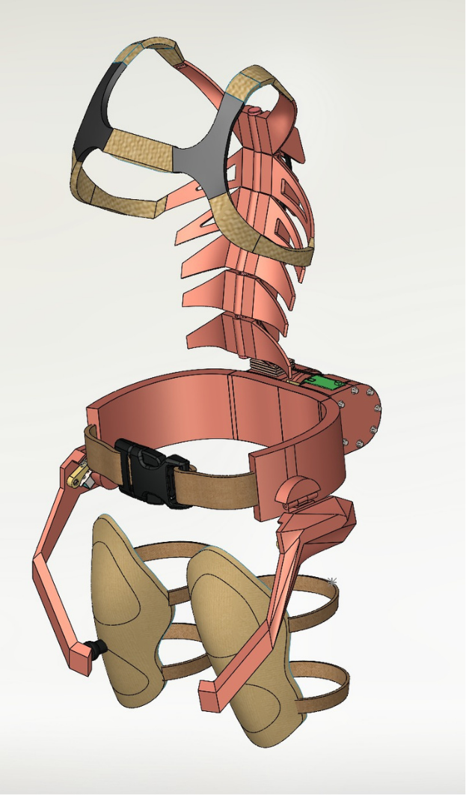

# Heavy Lift Actuated Exoskeleton

**For aiding humans in industrial and general-purpose lifting.**

---

# Introdution

Workers in construction, warehousing and manufacturing often lift heavy loads and perform repetitive bending tasks. These activities put excessive stress on the **lower back and spine**, leading to muscle fatigue, poor posture, reduced productivity and long-term musculoskeletal disorders (MSDs).

We aim to design an intelligent, energy-efficient **lower-back assist exoskeleton** that redistributes and supports a fraction of the load that would otherwise be carried by the muscles.

We started this project to address people working in automotive garages, backyards or ports, where continuous and somewhat random lifting of heavy objects happens at different angles. A multi-axis lifting machine would need many actuators and a complex mechanism. Instead, we build on the best machine already available, the human body, and assist it where it tires most.

### Basic Overview

When a person lifts an object, the main point of fatigue is the **lower back**. We provide an artificial "bone" structure that supports the backbone during the lifting phase.

---

## How to Connect to This Project (MATLAB / Simulink)

No commands needed. Everything is done with buttons inside MATLAB.

### Before you start (one time)

1. Create a free account at [github.com](https://github.com).
2. Send your GitHub username to the project owner. They will add you as a **collaborator**.
3. Open your email (or github.com notifications) and **accept the invitation**.
4. Create a **Personal Access Token** (it works as your password in MATLAB):
   - GitHub → profile picture → **Settings** → **Developer settings**
   - **Personal access tokens → Tokens (classic) → Generate new token (classic)**
   - Name it `matlab`, tick the **repo** box, click **Generate token**
   - **Copy it right away.** GitHub shows it only once.

### Step 1: Get the project (one time)

1. Open MATLAB.
2. Go to **Home → New → Project → From Git**.
3. Paste the repo link (green **Code** button on this page → **HTTPS** → copy).
4. Choose an empty folder on your computer and click **Retrieve**.
5. If asked to sign in, enter your GitHub **username** and paste the **token** as the password.

> Always open the project through its **`.prj` file** (Home → Open), not by double-clicking the `.slx` model. This sets up the folder paths so the CAD and data files are found.

### Step 2: Every time you work

| Step | What to do | Where |
|---|---|---|
| 1. **Pull** | Download the newest version | Source Control panel → **⋮** menu → **Pull** |
| 2. **Work** | Edit the model as usual | Simulink |
| 3. **Commit** | Tick your changed files, write a short message (e.g. `updated controller gain`), click **Commit** | Source Control panel → **Commit** |
| 4. **Push** | Upload your changes to GitHub | Source Control panel → **⋮** menu → **Push** |

> New files appear under **Untracked Files**. Tick the circle next to a file to include it in the commit.

### Team rules (avoid conflicts)

1. **Pull before you start. Push when you finish.**
2. **Only one person edits `Exoskeleton1.slx` at a time.** Simulink files cannot be merged easily. Tell the team before you push a model change.
3. Keep all data and CAD files **inside the project folder**. Files elsewhere (Desktop, Downloads) are not uploaded.
4. Do not upload auto-generated files: `slprj/`, `*.slxc`, `*.asv`, `*.autosave`.
5. Do not upload large files (GitHub rejects files over 100 MB).
6. Never delete the `.git` folder.

### If something goes wrong

| Problem | Fix |
|---|---|
| "No modified files to commit" | Tick the circles next to the files in **Untracked Files** first |
| "Unable to open project, no project definition files" | Open the `.prj` file from the cloned folder (Home → Open), and make sure the `.prj` and `resources` folder were pushed |
| Model says a file is not found | Open the project first (`.prj`), then the model |
| Asked for a password | Paste your **token**, not your GitHub password |
| Merge conflict on a model | Right-click the file in Source Control → **Resolve Conflict**, pick changes, save, commit and push |

---

## Project Files

| Item | Description |
|---|---|
| `Exoskeleton1.slx` | Main Simulink model |
| `lift_inputs.mat`, `lift_inputs_zeroed.xlsx` | Lifting input data |
| `.prj` and `resources/` | MATLAB project definition (needed to open the project) |
| CAD folders | Solid parts used by the Simscape Multibody blocks |
